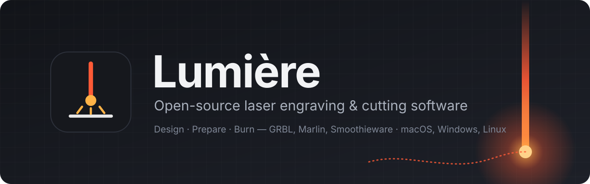
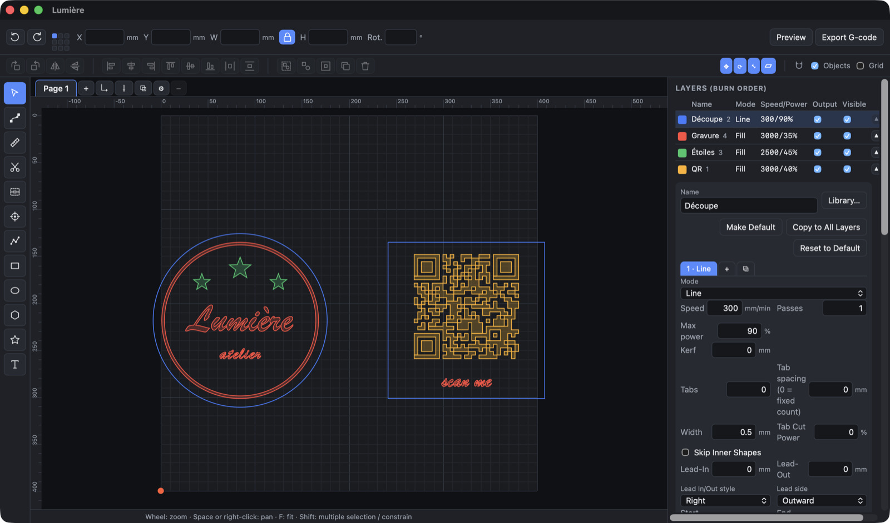
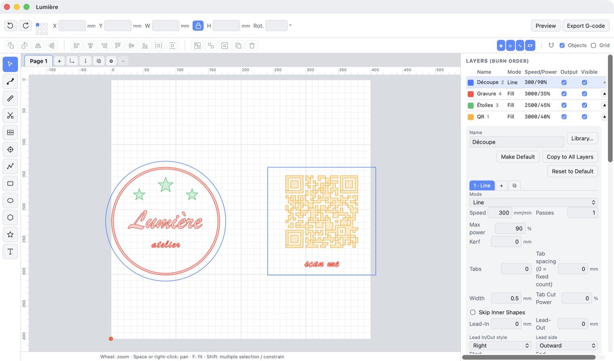

<p align="center">
  
</p>

<p align="center">
  <a href="https://github.com/timal-o/lumiere/releases/latest"></a>
  <a href="LICENSE"></a>
  <a href="https://github.com/timal-o/lumiere/actions/workflows/ci.yml"></a>
  
  <a href="https://github.com/timal-o/lumiere/releases"></a>
  <a href="https://github.com/timal-o/lumiere/stargazers"></a>
</p>

<p align="center">
  
  
  
  
  
  
  <a href="CONTRIBUTING.md"></a>
</p>

<p align="center">
  <a href="README.md">English</a> · <a href="README.fr.md">Français</a> · <a href="README.es.md">Español</a> · <b>简体中文</b>
</p>

<p align="center">
  <b>绘制、取景、雕刻。</b>为二极管和 CO₂ 激光器打造的完整、现代、免费的工作流程——<br>
  从第一笔草图到最后一遍加工，尽在一个快速的桌面应用中，任何人都可以阅读、修复和扩展。
</p>

<p align="center">
  
</p>

| 🎯 | **你将获得** |
|:-:|---|
| 🖊️ | 真正的矢量编辑器——贝塞尔曲线、节点、布尔运算、偏移、阵列、排版 |
| 🔥 | 所有常用切割设置——填充、线条、图像、区域填充、斜坡、桥接、引入线、子图层 |
| 🔌 | 通过 USB 或网络直接控制 **GRBL**、**Marlin** 和 **Smoothieware** |
| 📂 | 打开 **SVG · DXF · AI · EPS · PDF · HPGL · Gerber · STL · OBJ · 3MF** 以及 **LightBurn** 项目 |
| 🌍 | 界面支持 **English、Français、Español、简体中文**——新增语言只需一个 JSON 文件 |
| 🆓 | **GPL-3.0**——无需许可证密钥、无订阅、无遥测 |

---

## ✨ 功能

<table>
<tr>
<td width="50%" valign="top">

### 🖊️ 设计
- 贝塞尔曲线与完整的节点编辑
- 矩形、椭圆、多边形、星形、双星形——保持参数化
- 焊接、相减、相交、排除、布尔助手
- 偏移（向内、向外、双向）、圆角、倒角
- 网格与环形阵列——虚拟且可编辑
- 沿路径复制、排版（多页）、沿直线镜像
- 变形、斜切、两点旋转/缩放
- 为图形和图像生成外轮廓
- 从分段导入中恢复圆弧和直线

</td>
<td width="50%" valign="top">

### 🔤 文本与码
- 系统字体和 AutoCAD **SHX** 单线字体
- 路径文字（字母变形）、弧形文字
- 变量文本：序列号、日期、时间、**CSV 合并**
- **二维码**（Wi-Fi、联系人、邮件、网址、中心徽标）
- **DataMatrix** ECC200
- 一维条码：Code 128、Code 39、EAN、UPC、ITF-14、Codabar

</td>
</tr>
<tr>
<td valign="top">

### 🔥 图层与切割设置
- 线条、填充、偏移填充和图像模式，支持子图层
- 区域填充、交叉填充、每遍角度递增
- 割缝补偿、桥接（手动或按间距）、穿孔、过切
- 功率斜坡、印章斜坡、引入/引出线、穿透暂停
- 全局遍数、恒定功率（M3）、仅切割时开启气辅
- 材料库——以及 LightBurn `.clb` 导入/导出
- 材料、间隔和焦距测试网格及预设

</td>
<td valign="top">

### 🖼️ 图像
- 抖动：阈值、有序、Floyd–Steinberg、Jarvis、Stucki、Atkinson、半色调、报纸、素描、灰度
- 亮度、对比度、伽马、增强、降噪、反相
- 分层 3D 浮雕，STL / OBJ / 3MF 深度图
- 带实时预览的描摹：轮廓、中心线、素描
- 蒙版、裁剪、图像预设

</td>
</tr>
<tr>
<td valign="top">

### 🎛️ 机器控制
- USB 串口或 TCP，自动检测控制器
- 点动（步进或连续）、回原点、用户原点、保存位置
- 取景：边界框、外壳或轮廓，激光开或关
- 实时速度/功率调节、暂停、继续、停止
- 考虑加速度的路径预览与时间估算
- 可从预览中的任意位置开始
- 旋转轴（滚轮或卡盘，Y 轴或 A 轴）、每遍 Z、反向间隙补偿

</td>
<td valign="top">

### 🏭 生产
- 摄像头叠加、镜头校准和 9 点对齐
- 打印并切割、找圆心、锥形校正
- 作业计数与日志、作业前检查清单
- 多页面、素材库、宏、配置文件、捆绑包
- 新手模式、浅色和深色主题、可自定义快捷键
- 导出 SVG、DXF、PDF/AI、G 代码和 Ruida `.rd`

</td>
</tr>
</table>

> **从 LightBurn 迁移？** Lumière 采用相同的菜单布局、名称和快捷键，可打开你的 `.lbrn` / `.lbrn2`
> 项目（图层、设置、图形、可编辑文本），并导入 `.clb` 材料库。

<p align="center">
  
</p>

## 🚀 快速开始

**下载**——最简单的方式是访问网站 **[timal-o.github.io/lumiere](https://timal-o.github.io/lumiere/)**，它会为你的电脑选择合适的安装包。所有文件也可在 [Releases](https://github.com/timal-o/lumiere/releases) 页面获取。

| 🪟 Windows | 🐧 Linux | 🍎 macOS |
|:-:|:-:|:-:|
| `.msi` · `.exe` | `.deb` · `.rpm` · `.AppImage` | `.dmg`（Apple Silicon · Intel） |

> [!NOTE]
> **Mac：** 应用尚未经过 Apple 公证，较新的 macOS 会提示下载的 `.dmg`“已损坏”。
> 请改用终端中的一行命令安装——它会下载合适的版本并打开：
> ```sh
> curl -fsSL https://timal-o.github.io/lumiere/install.sh | bash
> ```

**从源码构建**——需要 [Node.js](https://nodejs.org) 18+、[Rust](https://rustup.rs)（稳定版）
以及适用于你系统的 [Tauri 依赖](https://v2.tauri.app/start/prerequisites/)。

```sh
git clone https://github.com/timal-o/lumiere.git
cd lumiere
npm install
npm run tauri dev      # 以热重载方式运行应用
npm run tauri build    # 构建安装包（.dmg、.msi、.deb / .AppImage）
```

然后：使用 **激光工具 → 查找我的激光器…** 设置机器，绘制或导入设计，选择图层，**取景**，**开始**。
[快速入门指南](docs/user-guide.zh-CN.md) 会逐步说明。

## 🔌 硬件

| 控制器 | 连接 | 状态 |
|---|---|---|
| **GRBL 1.1**、FluidNC、grblHAL | USB 串口、TCP | ✅ 已用于实际雕刻和切割 |
| **Smoothieware** | USB 串口、TCP | 🧪 已实现并测试，等待实机反馈 |
| **Marlin**（激光模式） | USB 串口、TCP | 🧪 已实现并测试，等待实机反馈 |
| **Ruida**（CO₂ DSP） | UDP、`.rd` 文件 | ⚠️ 实验性 |
| 振镜（EZCad / JCZ） | — | 🗺️ 计划中 |

> [!WARNING]
> 激光很危险。请佩戴合适的护目镜，切勿让运行中的作业无人看管，并在附近备好灭火器。新设置请先以低功率测试。

## 📂 文件格式

| | 格式 |
|---|---|
| **打开** | `.lum`（Lumière）、`.lbrn` / `.lbrn2`（LightBurn） |
| **导入矢量** | SVG、DXF、AI、EPS、PDF、HPGL / PLT、Gerber（RS-274X）+ Excellon 钻孔 |
| **导入图像** | PNG、JPEG、BMP、GIF、WebP |
| **导入 3D** | STL、OBJ、3MF → 深度图 |
| **导出** | SVG、DXF（R12）、PDF / AI、G 代码、处理后的位图、Ruida `.rd` |
| **库** | 材料（`.json`、LightBurn `.clb`）、素材、图像与测试预设、捆绑包 |

## 📚 文档

- 📖 [用户指南](docs/user-guide.zh-CN.md)——另有 [English](docs/user-guide.md)、[Français](docs/user-guide.fr.md)、[Español](docs/user-guide.es.md) 版本
- 🔧 [硬件](docs/hardware.md) · 🌍 [翻译](docs/translating.md) · 🏗️ [架构](docs/architecture.md) · 🗂️ [文件格式](docs/file-format.md) · 🛠️ [开发](docs/development.md)（英文）

## 🤝 参与贡献

欢迎提交问题报告、实机测试结果、翻译和 Pull Request——请先阅读 [CONTRIBUTING.md](CONTRIBUTING.md)，
并遵守[行为准则](CODE_OF_CONDUCT.md)。

## 📄 许可证

Lumière 是基于 [GNU 通用公共许可证 v3.0](LICENSE) 的自由软件：你可以使用、学习、修改和分享——
你分发的修改版本须采用相同的许可证。

<sub>Lumière 是独立项目，与任何商业激光软件厂商无关，也不包含其任何代码。产品名称归其各自所有者所有。</sub>
